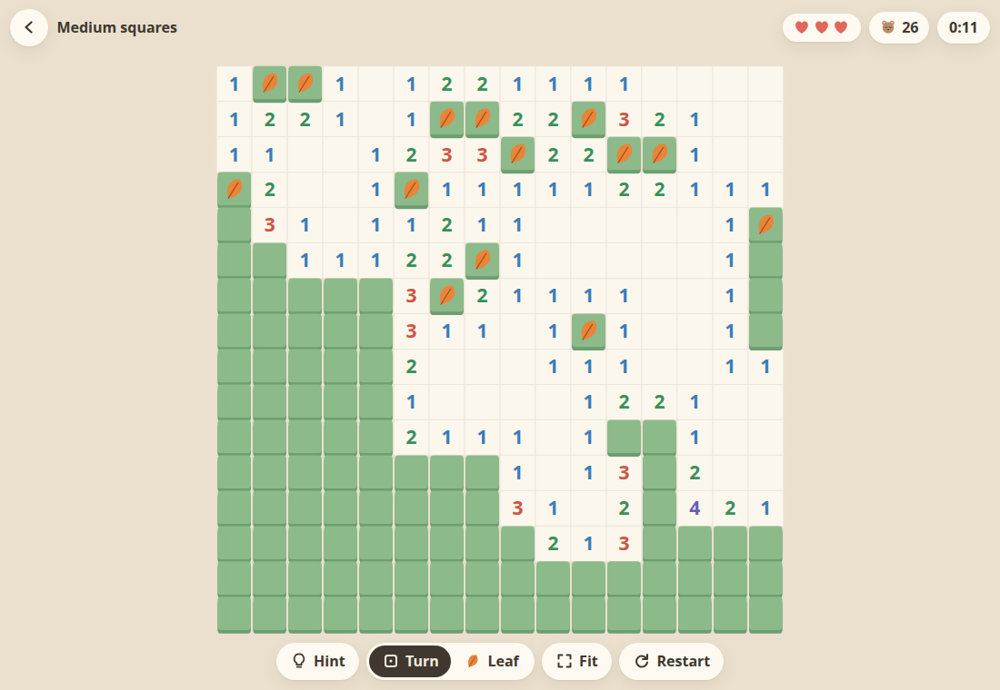
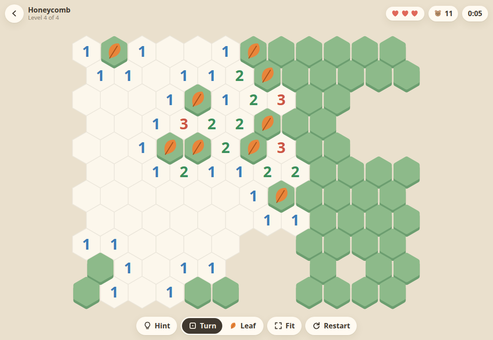
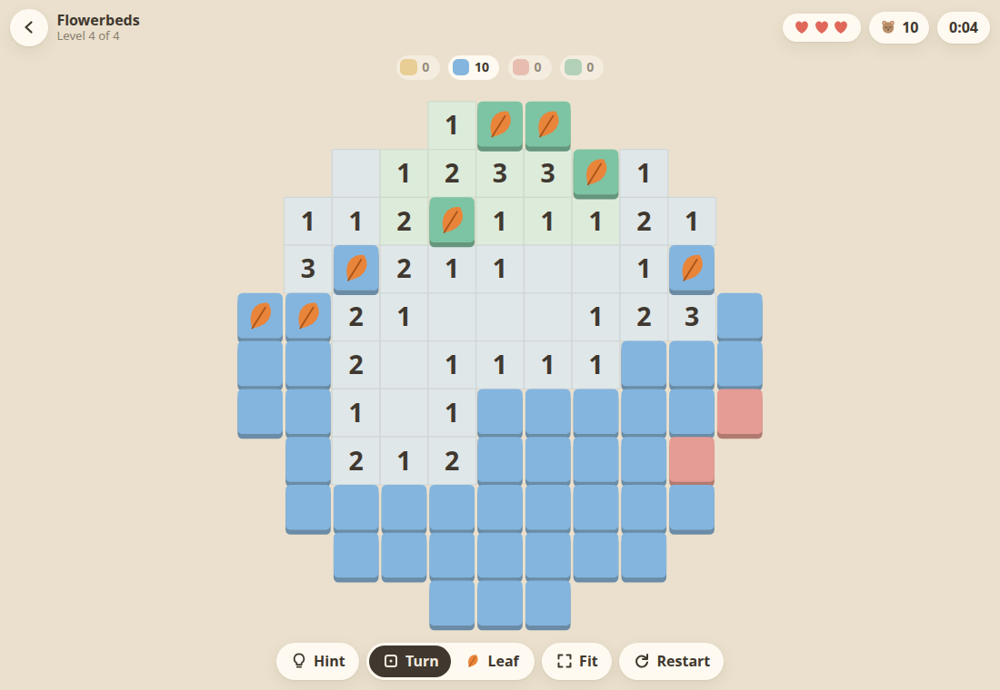
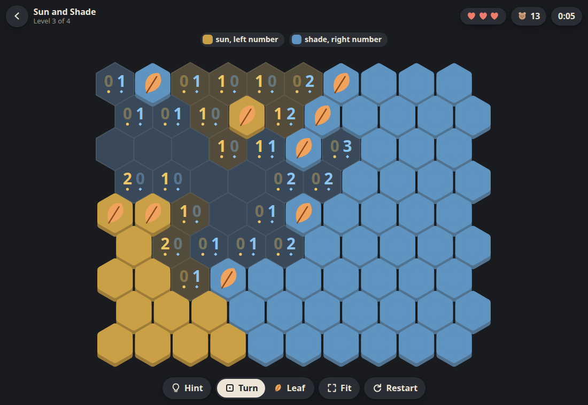
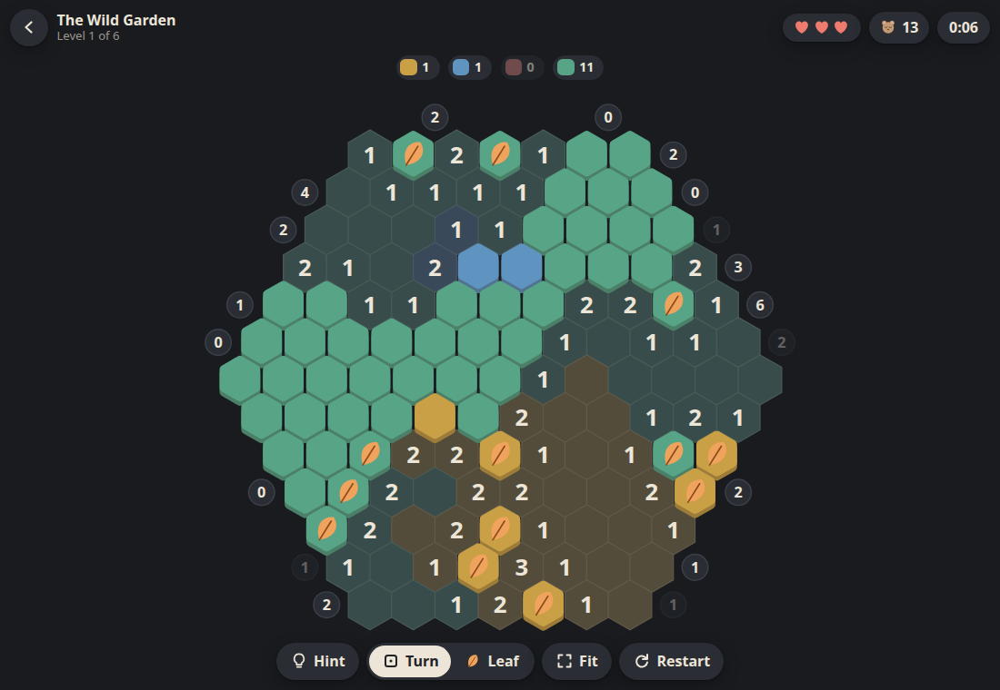
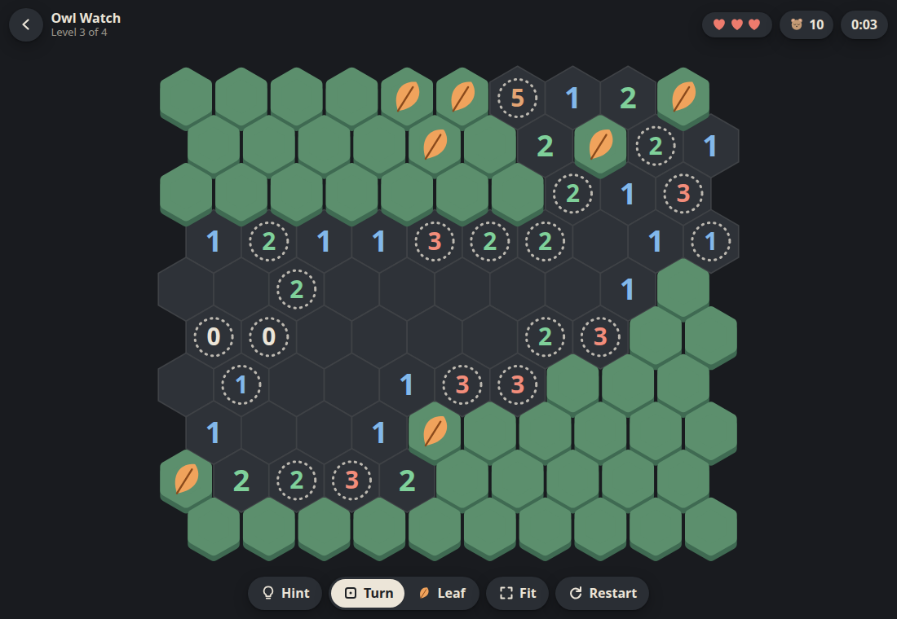
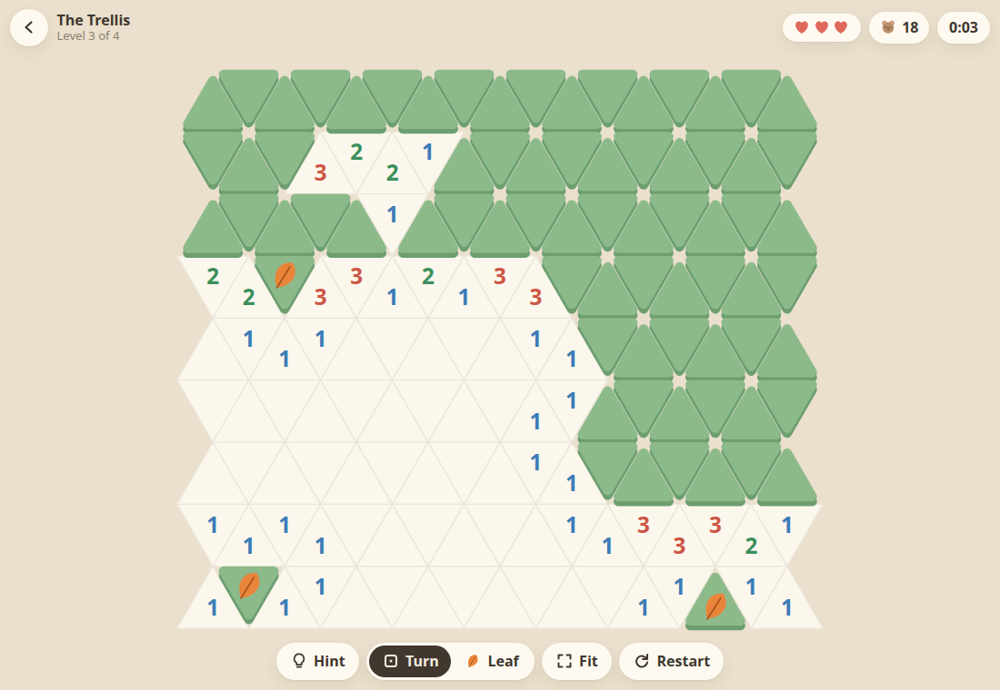
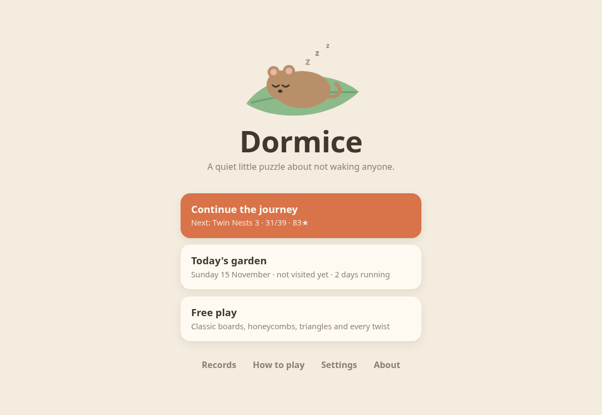
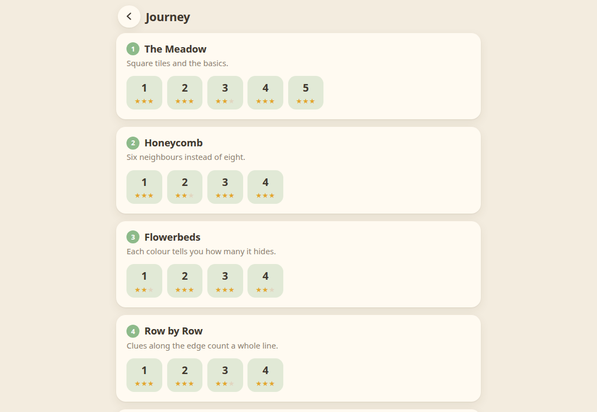

# Dormice

A cozy logic puzzle about not waking anyone. Dormice sleep under some of the
tiles, numbers tell you how many are nearby, and you turn over every tile that
is empty. If you know Minesweeper you already know how to start, and there is
a lot more to find from there.

## What you get

- **The classic game** on square boards: Beginner, Intermediate and Expert.
- **Honeycombs and triangles**, and gardens in shapes like rings, diamonds and ponds.
- **Colour rules**: flowerbeds that count their own sleepers, sun-and-shade clues that count two colours apart, and twin nests that hold two or none.
- **Extra clues**: numbers along the edge that count a whole row, and owls that see two steps away.
- **A Journey** of 39 levels that teaches one idea at a time, a new **daily garden** every day, and **free play** where you mix everything yourself.
- **No guessing**: every board can be finished by thinking. Stuck? The hint explains the next step instead of just showing it.
- **Records** for your fastest times, light and dark themes, and mouse, touch or keyboard play.

| | |
|---|---|
|  |  |
|  |  |
|  |  |
|  |  |

## Play

**As an app on Linux, Mac or Windows:** download the installer for your
computer from the [Releases](../../releases) page. The apps are not signed
with a paid developer certificate, so Windows and macOS ask you to confirm
before the first start. On a Mac: *System Settings › Privacy & Security*, then
*Open Anyway*.

**In a browser:** Dormice is a plain web page with nothing to install. To run
it from this folder:

    npm start

and open http://127.0.0.1:8377.

## How to play

| | Mouse | Touch | Keyboard |
|---|---|---|---|
| Turn a tile | left click | tap | Space |
| Lay a leaf where a dormouse sleeps | right click | press and hold | F |
| Turn the rest around a number | click the number | tap the number | Space on it |
| Zoom and move the board | wheel, drag | pinch, drag | |
| Ask for a hint | | | H |

## For developers

No dependencies and no build step for the game itself; `npm test` runs the
logic tests. The desktop apps are built from the `desktop` folder
(`npm install && npm run dist`), and pushing a version tag such as `v1.0.0`
builds all three and attaches them to a release.

The Android app is a small shell in the `android` folder: one screen that
shows the game from files packed into the app, with no libraries and no
network access. Build it with the Android SDK installed:

    cd android && ./gradlew assembleDebug

The game files are copied in on every build. `android/app/build.gradle`
carries the same version as `desktop/package.json`; a test checks they agree.

The iOS app in the `ios` folder is the same idea in Swift. Its Xcode project
is generated from `ios/project.yml`; on a Mac:

    brew install xcodegen
    cd ios && xcodegen && open Dormice.xcodeproj

`ios/ci/smoke.sh` builds it and plays a few steps in the simulator.

## Licence

MIT, see [LICENSE](LICENSE). That covers the code and the artwork.

Made by [Dirk Primbs](https://primbs.ca).
